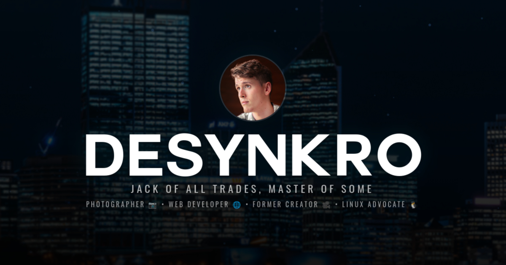

# DeSynkro

My personal portfolio for my photography, videos, web development, and open-source projects. Built with plain HTML, CSS, and JavaScript.

[](LICENSE)

Built by [Me 😄️](https://desynkro.com) with assistance from [Opencode](https://opencode.ai).

I always open-source my work as a way to give back to the community, thank you to everyone who was welcoming and kind 🥰️

## Requirements

- [Docker](https://docs.docker.com/engine/install/) with the Compose plugin

## Quick start

```bash
git clone https://codeberg.org/DeSynkro/desynkro-website.git
cd desynkro-website
docker compose up -d
```

Open [http://localhost:8081](http://localhost:8081)

## Screenshots

[](https://desynkro.com)

## Structure

```
├── index.html               Home page (about, services, contact, carousel)
├── portfolio.html           Portfolio gallery with categories
├── docker-compose.yml       Nginx setup
├── CHANGELOG.md             Version history
├── css/
│   └── styles.css           All styles
├── js/
│   ├── script.js            Home page logic
│   └── portfolio-data.js    Portfolio data and category definitions
├── images/
│   ├── hero/                Hero background (WebP + JPEG)
│   ├── frontpage/           Carousel slides (6 items, WebP + JPEG)
│   └── logos/               Favicons and header logo
├── portfolio/
│   ├── photography/         Photo galleries (animals, cosplays, models, etc.)
│   ├── animations/          Video animations with poster frames
│   ├── websites/            Web project demos
│   └── projects/            Coding project thumbnails
├── fonts/
│   ├── couture/             Couture Bold (headings)
│   └── oswald/              Oswald (body text)
├── .well-known/
│   └── security.txt         Security contact
├── LICENSE                  MIT
└── README.md                This file
```

## About

This is my personal portfolio. I built it after making the [WCI-Website](https://wci-dig.com) for my father's earthmoving business. That project inspired me to try and rebuild my own website, so here we are. Plain HTML, CSS, and JavaScript. My original website was built by my friend [Kira Kitsune](https://kirakitsune.dev/) and this re-creation was heavily inspired by her original design.

## Features

- Responsive design (desktop, tablet, mobile)
- About carousel with text/title crossfade toggle
- Portfolio category browser (Photography, Websites, Animations, Videos, Coding)
- Photo galleries with lightbox viewer
- Video and animation playback in lightbox
- Optimized images (WebP with JPEG fallback via `<picture>`)
- Self-hosted fonts with `font-display: swap`
- SEO metadata (Open Graph, Twitter cards)
- Keyboard and screen-reader friendly
- Docker support with Nginx
- Zero dependencies, no frameworks, no build tools

## Tech Stack

| What | How |
|------|-----|
| Structure | HTML5 with semantic landmarks |
| Styling | CSS3 (custom properties, flexbox, grid, animations) |
| Logic | Vanilla JavaScript (no libraries) |
| Icons | Inline SVG |
| Fonts | Couture Bold + Oswald (self-hosted WOFF2) |
| Images | WebP with JPEG fallback, `image-set()` for backgrounds |
| Server | Nginx via Docker Compose |

## Deployment

The site runs in an Nginx Docker container:

```bash
docker compose up -d
```

## License

MIT. See [LICENSE](LICENSE).

## Credits

- Built by [DeSynkro](https://desynkro.com)
- Assisted by [Opencode](https://opencode.ai)
- Original Design by [Kira Kitsune](https://kirakitsune.dev/)
- Thank you to everyone who was welcoming and kind, it means a lot 😄️

<p align="center">
  <a href="https://desynkro.com" target="_blank">
    
  </a>
</p>
